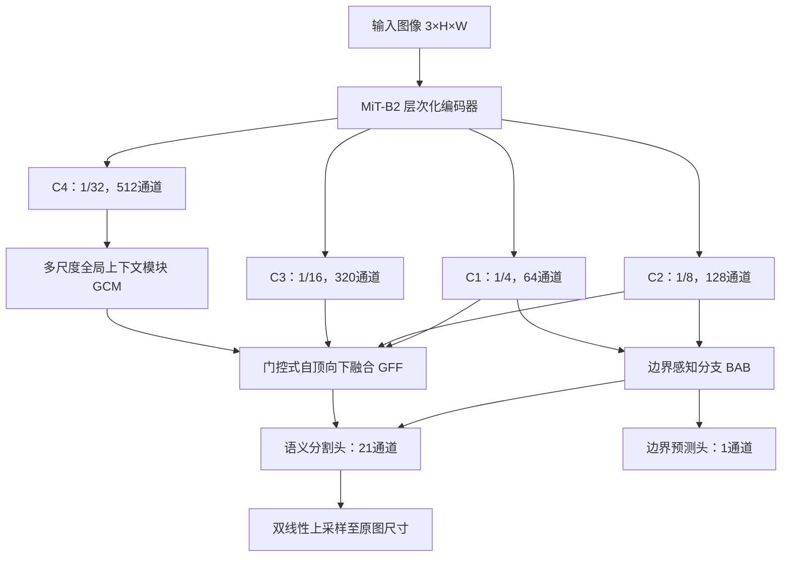

# Artificial Intelligence Technology Project

## Pascal VOC2012 Semantic Segmentation：完整项目实施方案

> 方案版本：V1.0
> 任务类型：21 类语义分割（20 个前景类别 + 背景）
> 核心评价指标：mIoU
> 已确认允许：ImageNet 预训练、SBD 扩充数据、多尺度测试、翻转测试、模型集成

---

## 1. 项目目标与总体路线

本项目需要完成 Pascal VOC2012 语义分割模型的设计、训练、验证和测试集推理，最终提交训练代码、模型权重、400 张测试图像的单通道灰度预测掩码，以及完整实验报告。

考虑到最终成绩重点取决于 mIoU，同时还需要体现独立的模型设计与实验分析，本方案采用以下总体路线：

1. 使用官方 VOC2012 train/val 建立严格、可复现的基线；
2. 引入 SBD 构建 VOC `trainaug`，扩大像素级标注训练集；
3. 以 ImageNet 预训练的 MiT-B2 为编码器，自行设计多尺度上下文、门控特征融合和边界辅助分支；
4. 使用交叉熵、Lovász-Softmax、边界损失和辅助损失联合优化；
5. 通过消融实验验证各模块的实际贡献；
6. 超参数确定后，用全部允许的标注数据重新训练最终模型；
7. 使用多尺度、水平翻转和异构模型集成生成最终预测；
8. 对预测文件数量、尺寸、通道、数据类型和标签范围进行自动检查。

推荐主模型命名为：

> **GCB-Seg：Global Context and Boundary-aware Segmentation Network**
> 中文名称：全局上下文与边界感知语义分割网络

该模型以层次化 Transformer 提取全局语义，用 CNN 式上下文模块和解码器恢复多尺度空间细节，并通过边界辅助任务改善细小目标和轮廓区域。

---

## 2. 数据集定义与标签规范

### 2.1 VOC2012 官方数据

VOC2012 语义分割官方划分为：

| 划分 | 图像数量 | 本项目用途 |
|---|---:|---|
| train | 1,464 | 基线训练、消融训练 |
| validation | 1,449 | 模型选择和超参数调整 |
| trainval | 2,913 | 最终训练时可与 SBD 新增数据合并 |
| 课程测试集 | 400 | 只推理，不参与训练和人工调参 |

题目材料中的 1,465/1,450 与官方列表相差 1 张，程序应以 `ImageSets/Segmentation/train.txt` 和 `val.txt` 的实际内容为准。

### 2.2 标签编码

| 像素值 | 含义 |
|---:|---|
| 0 | background |
| 1–20 | VOC20 个前景类别 |
| 255 | void/ignore，不参与训练和评价 |

标签应直接读取为索引矩阵：

```python
mask = np.asarray(Image.open(mask_path), dtype=np.uint8)
```

禁止在读取标签时执行 `.convert("RGB")`，否则类别索引会被转换成调色板颜色。图像缩放可以使用双线性或双三次插值，但标签缩放只能使用最近邻插值。

### 2.3 SBD 的使用原则

SBD 用于增加额外人工标注样本，不修改 VOC2012 原始图像和原始标签。建议保留两套独立目录：

```text
VOCdevkit/
└── VOC2012/
    ├── JPEGImages/
    ├── SegmentationClass/          # VOC 官方标签，永久保留
    ├── SegmentationClassAug/       # VOC + SBD 合并标签
    └── ImageSets/
        └── Segmentation/
            ├── train.txt
            ├── val.txt
            ├── trainval.txt
            └── train_aug.txt
```

标准 `trainaug` 约含 10,582 张图像，其构造原则是：

- 保留 1,464 张 VOC 官方 train；
- 增加 SBD 提供的额外标注图像；
- 按图像 ID 去重；
- 严格排除 VOC 官方 val 的全部 1,449 个图像 ID；
- 对 VOC 官方 train 与 SBD 的重合图像，优先使用 VOC 官方标签；
- SBD 新增标签转换为单通道 PNG 后存入 `SegmentationClassAug`；
- 不覆盖原始 `SegmentationClass`。

必须加入如下防泄漏检查：

```python
train_aug_ids = set(read_ids("train_aug.txt"))
val_ids = set(read_ids("val.txt"))
assert train_aug_ids.isdisjoint(val_ids), "Data leakage: val image found in train_aug"
assert len(train_aug_ids) == len(set(train_aug_ids)), "Duplicated image IDs"
```

### 2.4 数据质量检查

训练前自动完成以下检查，并将结果保存到日志：

1. 每个图像 ID 都能找到图像和掩码；
2. 图像与掩码宽高完全一致；
3. 标签唯一值只能属于 `{0, 1, ..., 20, 255}`；
4. `train_aug` 与 `val` 交集为空；
5. 文件列表中不存在重复 ID；
6. 统计每个类别的图像出现次数和像素数；
7. 随机可视化至少 20 组图像与掩码叠加结果；
8. 确认 SBD 转换后不存在类别偏移、转置或上下翻转。

建议输出：

```text
artifacts/data_check/
├── split_summary.json
├── class_pixel_statistics.csv
├── invalid_samples.txt
└── overlays/
```

---

## 3. 模型方案选择

### 3.1 为什么不直接采用标准 YOLO-Seg

YOLO-Seg 通常解决实例分割问题，为每个检测目标输出独立掩码；本项目要求的是单张图像中每个像素唯一对应一个语义类别。直接使用 YOLO-Seg 需要额外解决实例重叠、无检测框区域和同类实例合并等问题，与 VOC 的语义分割 mIoU 评价并不完全匹配。

如果希望借鉴 YOLO，可将 CSP/C2f 作为 CNN 编码器，但不建议把标准 YOLO 实例分割头作为主方案。

### 3.2 推荐方案比较

| 方案 | 优点 | 局限 | 用途 |
|---|---|---|---|
| U-Net/自建 CNN | 实现简单、边界恢复直观 | 全局建模不足，mIoU 上限可能较低 | 调试或低配基线 |
| DeepLabV3+ ResNet50 | 稳定、成熟、多尺度能力强 | 模型创新度有限 | CNN 强基线、集成模型 |
| SegFormer-B2 | 全局建模和多尺度特征较强 | 原始解码器较简单 | Transformer 基线 |
| GCB-Seg | 同时建模全局语义、多尺度上下文和边界 | 实现和消融成本更高 | 推荐主模型 |

---

## 4. GCB-Seg 网络结构

### 4.1 总体结构



### 4.2 编码器

采用 ImageNet 预训练的 MiT-B2，输出四个尺度的特征：

| 特征 | 相对分辨率 | 原始通道数 | 主要信息 |
|---|---:|---:|---|
| `C1` | 1/4 | 64 | 边缘、纹理、细小结构 |
| `C2` | 1/8 | 128 | 局部形状和部件信息 |
| `C3` | 1/16 | 320 | 中高层语义信息 |
| `C4` | 1/32 | 512 | 全局语义和长距离关系 |

预训练编码器不是完全冻结，而是使用小学习率微调。新增模块使用较大学习率，以避免破坏预训练特征的同时让解码器充分学习。

### 4.3 多尺度全局上下文模块 GCM

对 `C4` 设置五个并行分支：

1. `1×1 Conv`；
2. `3×3 depthwise separable conv, dilation=1`；
3. `3×3 depthwise separable conv, dilation=3`；
4. `3×3 depthwise separable conv, dilation=6`；
5. 全局平均池化 + `1×1 Conv` + 上采样。

所有分支输出 64 通道，拼接后通过 `1×1 Conv` 压缩为 256 通道：

\[
F_4=\operatorname{Conv}_{1\times1}
\left[ B_1(C_4),B_2(C_4),B_3(C_4),B_4(C_4),B_5(C_4) \right]
\]

每个卷积块建议采用：

```text
Conv → GroupNorm → GELU → Dropout2d
```

小 batch 情况下优先使用 GroupNorm，避免 BatchNorm 统计不稳定。

### 4.4 门控特征融合模块 GFF

首先用 `1×1 Conv` 将 `C1–C3` 投影为统一的 256 通道。对每一级执行：

\[
G_i=\sigma\left(\operatorname{Conv}_{1\times1}
\left[P_i,\operatorname{Up}(F_{i+1})\right]\right)
\]

\[
F_i=P_i+G_i\odot\operatorname{Up}(F_{i+1})
\]

其中，`P_i` 是编码器对应层的投影特征，`G_i` 是像素级门控权重。融合结果再经过两个深度可分离卷积进行细化。

与直接相加相比，门控结构允许网络根据空间位置选择深层语义或浅层细节，有利于处理大目标内部一致性和小目标轮廓之间的冲突。

### 4.5 边界感知分支 BAB

将 `C1` 与上采样后的 `C2` 拼接，通过两个 `3×3` 卷积输出：

- 一张 1 通道边界 logit；
- 一组 64 通道边界特征。

边界特征与最终 `F1` 拼接后进入分割头，使边界监督不仅形成辅助损失，还能直接参与语义预测。

边界真值由语义标签自动生成：

1. 比较像素与上下左右邻域的类别是否不同；
2. 类别发生变化的位置记为边界；
3. 使用 3×3 结构元素膨胀 1 次，形成约 2–3 像素宽边界；
4. 涉及 255 的位置设为边界忽略区域；
5. 不把图像外边缘自动视为目标边界。

### 4.6 分割头和辅助头

主分割头：

```text
Concat(F1, boundary_feature)
→ 3×3 Conv
→ GroupNorm
→ GELU
→ Dropout2d(0.1)
→ 1×1 Conv(21)
→ 上采样到输入尺寸
```

在 `F3` 上增加辅助分割头，输出 21 通道预测。辅助头仅在训练时使用，推理时移除，不增加最终推理开销。

### 4.7 模型输出约定

训练模式返回：

```python
{
    "logits": main_logits,      # [B, 21, H, W]
    "aux_logits": aux_logits,  # [B, 21, H, W]
    "edge_logits": edge_logits # [B, 1, H, W]
}
```

推理模式只需主分割 logits。

---

## 5. 损失函数

### 5.1 总损失

初始推荐配置为：

\[
\mathcal{L}=
\mathcal{L}_{CE}
+0.5\mathcal{L}_{Lovasz}
+0.2\mathcal{L}_{edge}
+0.4\mathcal{L}_{aux}
\]

其中：

- `L_CE`：主分支像素级交叉熵；
- `L_Lovasz`：面向 mIoU 的 Lovász-Softmax 损失；
- `L_edge`：边界 BCE 与 Dice 的组合；
- `L_aux`：辅助分割头交叉熵。

### 5.2 交叉熵

```python
criterion_ce = nn.CrossEntropyLoss(
    ignore_index=255,
    label_smoothing=0.05
)
```

模型输出必须是未经 Softmax 的 logits，标签形状为 `[B,H,W]`、类型为 `torch.long`。

暂不建议一开始使用很强的类别权重。先统计类别像素频率并完成无权重基线；若 `bottle`、`chair`、`pottedplant` 等类别 IoU 长期明显偏低，再尝试中位频率权重，并将权重裁剪到 `[0.5, 3.0]`。

### 5.3 Lovász-Softmax

仅对非 255 像素计算，并设置为只处理当前 batch 中实际出现的类别。其目标是缩小交叉熵与最终 mIoU 指标之间的优化差异。

### 5.4 边界损失

推荐：

\[
\mathcal{L}_{edge}=
0.5\mathcal{L}_{BCE}+0.5\mathcal{L}_{Dice}
\]

边界像素比例较低，BCE 可设置 `pos_weight`，但应从训练集边界像素统计得到，并限制在合理范围内，避免训练不稳定。

---

## 6. 数据增强方案

### 6.1 训练增强

图像和标签同步执行几何增强：

| 增强 | 参数 |
|---|---|
| 随机缩放 | `0.5–2.0` |
| 随机裁剪 | `512×512` |
| 类别均衡裁剪 | `cat_max_ratio=0.75` |
| 水平翻转 | `p=0.5` |
| 小图填充 | 图像填均值，标签填 255 |

仅图像执行颜色增强：

| 增强 | 参数建议 |
|---|---|
| ColorJitter | brightness/contrast/saturation = 0.2，hue = 0.05 |
| GaussianBlur | `p=0.1` |
| RandomGrayscale | `p=0.05`，可在消融中决定是否保留 |

最后使用 ImageNet mean/std 归一化。

不建议使用上下翻转、大角度旋转或非常强的透视变换，因为自然场景存在明确方向性。

### 6.2 可选增强

可将 Segmentation CutMix 作为后期对比项，而不是默认启用。CutMix 必须同时裁剪和粘贴图像及语义标签，并保留 255 区域。若 validation mIoU 没有稳定改善，则不进入最终配置。

### 6.3 验证增强

验证阶段禁止随机变换。建议：

- 保持原始长宽比；
- 将宽高填充至 32 的倍数；
- 模型输出恢复到原始图像尺寸；
- 单尺度、无翻转结果作为标准验证指标；
- TTA 结果单独报告，不能与单尺度结果混写。

---

## 7. 训练配置

### 7.1 推荐默认参数

| 项目 | 配置 |
|---|---|
| 框架 | PyTorch |
| 输入裁剪 | 512×512 |
| 编码器 | MiT-B2，ImageNet 预训练 |
| 优化器 | AdamW |
| 编码器学习率 | `6e-5` |
| 新增模块学习率 | `3e-4` |
| Weight decay | `0.01` |
| 学习率策略 | Linear warmup + Poly |
| Poly power | `0.9` |
| Warmup | 1,000–1,500 iterations |
| 有效 batch size | 8 |
| AMP | 开启 |
| 梯度裁剪 | `max_norm=1.0` |
| Dropout2d | 0.1 |
| 验证频率 | 每 1,000 iterations 或每 epoch |
| 保存 | best mIoU、last、定期 checkpoint |

偏置、LayerNorm 和 GroupNorm 参数不使用 weight decay。

### 7.2 学习率公式

Warmup 后使用：

\[
lr_t=lr_0\left(1-\frac{t}{T}\right)^{0.9}
\]

其中 `t` 为当前 iteration，`T` 为总 iteration。

### 7.3 显存适配

| 可用显存 | 建议配置 |
|---|---|
| 6–8 GB | MiT-B0/B1，384 crop，batch 2，梯度累积 |
| 10–16 GB | MiT-B2，512 crop，batch 2–4，梯度累积到 8 |
| 24 GB 以上 | MiT-B2/B3，512 crop，batch 4–8 |

若每卡 batch 小于 8，新增卷积模块优先使用 GroupNorm。编码器原有归一化结构保持不变。

### 7.4 训练阶段

#### 阶段 A：数据管线与 CNN 基线

- 数据：VOC train 1,464；
- 验证：VOC val 1,449；
- 模型：DeepLabV3+ ResNet50；
- 损失：CrossEntropy；
- 目的：验证读取、增强、损失、指标、保存和推理流程完全正确。

只有当训练损失下降、预测类别范围正确、validation mIoU 合理后，才能进入下一阶段。

#### 阶段 B：Transformer 基线

- 数据：VOC train；
- 模型：原始 SegFormer-B2；
- 损失：CrossEntropy；
- 目的：形成与自建模型同编码器的公平基线。

#### 阶段 C：GCB-Seg 消融

- 数据：先用 VOC train 快速筛选结构；
- 逐步添加 GCM、GFF、BAB、Lovász；
- 每次只改变一个因素；
- 所有实验使用同一随机种子、裁剪尺寸、训练长度和评价脚本。

#### 阶段 D：SBD trainaug 正式开发

- 训练：约 10,582 张 `train_aug`；
- 验证：1,449 张官方 val；
- 推荐先训练 40,000 iterations；
- 每 1,000 iterations 验证一次；
- 根据 validation mIoU 保存最佳模型；
- 如果最佳点仍持续上升，可延长到 60,000 iterations；
- 若后期 mIoU 明显下降，不使用 last，使用 best checkpoint。

#### 阶段 E：最终全数据训练

在全部结构、参数、损失权重和 TTA 方案确定后：

- 合并 `train_aug` 和官方 val；
- 按 ID 去重后约为 12,031 张标注图像；
- 使用阶段 D 中最佳 checkpoint 对应的 epoch 数训练；
- 不再利用 400 张测试图像进行选择；
- 保存最终权重和训练配置快照。

例如阶段 D 的最佳结果出现在第 32 个 epoch，则最终全数据训练也以约 32 个 epoch 为主，并可额外保存第 30、32、34 个 epoch 供内部稳定性检查。

### 7.5 可复现设置

固定并记录：

```text
Python、PyTorch、CUDA、cuDNN 版本
GPU 型号与数量
随机种子
训练图像列表的哈希值
配置文件完整内容
Git commit id（若使用 Git）
预训练权重名称与来源
```

建议开发实验统一使用 `seed=42`，最终候选模型可使用不同种子训练，以增加集成多样性。

---

## 8. 评价指标与实现

### 8.1 核心指标

对类别 `c`：

\[
IoU_c=\frac{TP_c}{TP_c+FP_c+FN_c}
\]

\[
mIoU=\frac{1}{21}\sum_{c=0}^{20}IoU_c
\]

主结果按 21 类（含背景）平均。标签 255 必须在构造混淆矩阵前删除。

### 8.2 混淆矩阵高效实现

```python
valid = target != 255
target = target[valid]
pred = pred[valid]
hist = torch.bincount(
    21 * target + pred,
    minlength=21 ** 2
).reshape(21, 21)
```

累计整个 validation 数据集后再计算 IoU，不能先计算每张图的 mIoU 再直接平均，否则类别缺失会造成偏差。

### 8.3 辅助指标

- Pixel Accuracy；
- Mean Pixel Accuracy；
- 每类 IoU；
- 前景 20 类平均 IoU（附加报告，不代替官方 mIoU）；
- 参数量；
- FLOPs；
- 单张推理时间；
- 峰值显存。

---

## 9. 消融实验与模型对比

### 9.1 主对比实验

| 编号 | 模型 | 预训练 | 训练数据 | 目的 |
|---|---|---|---|---|
| B1 | U-Net/轻量 CNN | 可选 | VOC train | 基础模型参考 |
| B2 | DeepLabV3+ ResNet50 | ImageNet | VOC train/trainaug | CNN 强基线 |
| B3 | SegFormer-B2 | ImageNet | VOC train/trainaug | Transformer 基线 |
| P | GCB-Seg | ImageNet | VOC trainaug | 推荐模型 |

### 9.2 结构消融

| 实验 | GCM | GFF | BAB | Lovász | 目标 |
|---|:---:|:---:|:---:|:---:|---|
| A0 |  |  |  |  | 原始 SegFormer-B2 |
| A1 | ✓ |  |  |  | 验证多尺度上下文 |
| A2 | ✓ | ✓ |  |  | 验证门控特征融合 |
| A3 | ✓ | ✓ | ✓ |  | 验证边界分支 |
| A4 | ✓ | ✓ | ✓ | ✓ | 完整 GCB-Seg |

每组记录：

```text
单尺度 mIoU
前景 mIoU
Pixel Accuracy
各类别 IoU
参数量和 FLOPs
推理速度
训练峰值显存
```

### 9.3 训练策略消融

| 实验 | 比较内容 |
|---|---|
| D1 | VOC train 与 SBD trainaug |
| D2 | CE 与 CE + Lovász |
| D3 | 普通随机裁剪与类别均衡裁剪 |
| D4 | 单尺度与多尺度训练 |
| D5 | 单尺度推理与 TTA |
| D6 | 单模型与模型集成 |

报告中必须区分“结构提升”“增加训练数据带来的提升”和“推理增强带来的提升”，不能把三者混为模型创新。

---

## 10. 多尺度测试与翻转测试

### 10.1 推荐 TTA

对每张测试图像使用以下尺度：

```text
0.75×、1.00×、1.25×
```

每个尺度分别执行：

- 原图推理；
- 水平翻转图推理，输出再水平翻转回来。

共获得 6 组 logits：

\[
Z=\frac{1}{6}\sum_{s\in\{0.75,1.0,1.25\}}
\left(Z_s+\operatorname{FlipBack}(Z_s^{flip})\right)
\]

将所有 logits 双线性插值回原始图像尺寸后再平均，最后执行 `argmax`。不要先对各尺度结果 `argmax` 再投票，因为这会丢失置信度信息。

可以额外验证 `1.5×`，但只有当 validation mIoU 明确提高时才保留，以控制推理时间。

### 10.2 大图处理

优先整图推理并填充至 32 的倍数。若测试图像过大导致显存不足，再使用带重叠的滑窗：

```text
crop_size = 512×512
stride = 341×341 或 384×384
```

重叠区域使用概率或 logits 平均，不能让后一个窗口直接覆盖前一个窗口。

---

## 11. 模型集成方案

### 11.1 推荐候选模型

在 validation 上选择以下模型中的 2–3 个：

1. `GCB-Seg MiT-B2，seed=42`；
2. `GCB-Seg MiT-B2，另一随机种子`，或显存允许时使用 MiT-B3；
3. `DeepLabV3+ ResNet50/101`，提供不同于 Transformer 的 CNN 错误模式。

### 11.2 集成方式

不同模型 logits 的尺度可能不同，因此推荐先转为 Softmax 概率，再加权平均：

\[
P=\sum_{m=1}^{M}w_m\operatorname{Softmax}(Z_m),
\quad \sum_m w_m=1
\]

初始可测试：

```text
GCB-Seg：0.60
第二个 Transformer 候选：0.25
DeepLabV3+：0.15
```

权重必须根据 VOC val 的结果确定。若某个模型加入后 mIoU 下降，则不进入最终集成。不能因为模型数量更多就默认结果更好。

### 11.3 集成选择原则

除了单模型 mIoU，还应比较两个模型的预测差异。一个 mIoU 略低但与主模型错误互补的 CNN，可能比第二个高度相似的 Transformer 更适合集成。

推荐保留：

- 最佳单模型预测；
- 最佳双模型集成预测；
- 最佳三模型集成预测。

最终只提交在 validation 上验证最优且规则允许的版本。

---

## 12. TensorBoard 可视化

建议使用如下标签：

```text
Loss/train_total
Loss/train_ce
Loss/train_lovasz
Loss/train_edge
Loss/train_aux
Loss/val_ce
Metric/train_mIoU
Metric/val_mIoU
Metric/val_pixel_accuracy
Metric/val_foreground_mIoU
LearningRate/encoder
LearningRate/decoder
System/gpu_memory
Images/input
Images/ground_truth
Images/prediction
Images/error_map
Images/edge_prediction
```

可视化图像时应反归一化，并使用固定颜色表显示类别。每次验证使用固定样例，便于观察同一图像随训练进度的变化。

报告中至少放入：

1. 训练和验证损失曲线；
2. validation mIoU 曲线；
3. Pixel Accuracy 曲线；
4. 学习率曲线；
5. 各类别 IoU 柱状图；
6. 混淆矩阵；
7. 成功案例、失败案例和边界细节对比；
8. 完整消融实验表。

---

## 13. 测试集推理与预测文件

### 13.1 输出规范

每张预测掩码必须满足：

- 与对应测试图像宽高一致；
- PNG 格式；
- 单通道灰度图；
- `uint8` 类型；
- 像素值仅为 `0–20`；
- 不输出 255；
- 文件名与测试图像一致，只把扩展名统一为 `.png`；
- 预测目录内正好有 400 张图像；
- 不把彩色可视化图放入提交预测目录。

保存示例：

```python
pred = logits.argmax(dim=1)[0]
pred = pred.cpu().numpy().astype(np.uint8)
Image.fromarray(pred, mode="L").save(output_path)
```

### 13.2 自动验收脚本

提交前逐张执行：

```python
assert len(pred_files) == 400

for image_path, pred_path in pairs:
    image = Image.open(image_path)
    pred = Image.open(pred_path)
    arr = np.asarray(pred)

    assert pred.mode in ("L", "P")
    assert pred.size == image.size
    assert arr.ndim == 2
    assert arr.dtype == np.uint8
    assert arr.min() >= 0
    assert arr.max() <= 20
```

若课程明确要求“gray scale”而不是调色板 PNG，最终统一保存为 `mode="L"`。

### 13.3 测试集只能用于无监督检查

允许检查：

- 文件能否读取；
- 尺寸和格式是否正确；
- 是否存在全背景预测；
- 推理是否崩溃；
- 预测可视化是否出现明显程序错误。

不应根据无标签测试图像反复人工选择模型或手工修改掩码。模型选择必须基于 validation 指标。

---

## 14. 代码工程结构

建议提交代码采用以下结构：

```text
code_studentname_studentid/
├── README.md
├── requirements.txt
├── configs/
│   ├── deeplabv3plus_r50.yaml
│   ├── segformer_b2.yaml
│   └── gcb_seg_b2.yaml
├── datasets/
│   ├── voc.py
│   ├── transforms.py
│   ├── sbd_converter.py
│   └── boundary_target.py
├── models/
│   ├── gcb_seg.py
│   ├── encoders/
│   │   └── mit.py
│   ├── modules/
│   │   ├── global_context.py
│   │   ├── gated_fusion.py
│   │   └── boundary_branch.py
│   └── baselines/
│       ├── deeplabv3plus.py
│       └── segformer.py
├── losses/
│   ├── segmentation_loss.py
│   └── lovasz.py
├── metrics/
│   └── segmentation_metrics.py
├── engine/
│   ├── trainer.py
│   ├── evaluator.py
│   └── checkpoint.py
├── tools/
│   ├── prepare_voc_sbd.py
│   ├── check_dataset.py
│   ├── train.py
│   ├── evaluate.py
│   ├── predict.py
│   ├── ensemble.py
│   └── validate_predictions.py
├── runs/                  # 可只附关键 TensorBoard 日志
├── checkpoints/           # 至少附最终模型或下载说明
└── outputs/               # 示例结果，不混入提交预测目录
```

### 14.1 推荐命令接口

```bash
python tools/prepare_voc_sbd.py --voc-root DATA/VOCdevkit/VOC2012 --sbd-root DATA/benchmark_RELEASE

python tools/check_dataset.py --config configs/gcb_seg_b2.yaml

python tools/train.py --config configs/gcb_seg_b2.yaml

python tools/evaluate.py --config configs/gcb_seg_b2.yaml --checkpoint checkpoints/best.pth

python tools/predict.py --config configs/gcb_seg_b2.yaml --checkpoint checkpoints/final.pth --tta

python tools/ensemble.py --manifest ensemble.yaml

python tools/validate_predictions.py --image-dir DATA/test --pred-dir predictions
```

### 14.2 Checkpoint 内容

每个 checkpoint 建议保存：

```python
{
    "model": model.state_dict(),
    "optimizer": optimizer.state_dict(),
    "scheduler": scheduler.state_dict(),
    "scaler": scaler.state_dict(),
    "epoch": epoch,
    "iteration": iteration,
    "best_miou": best_miou,
    "config": config,
    "class_names": class_names
}
```

---

## 15. 实验报告结构

### 15.1 摘要

说明任务、数据、主模型、主要改进、训练策略和最终 validation mIoU。不要在没有测试标签的情况下虚构测试 mIoU。

### 15.2 数据处理与加载

包括：

- VOC2012 和 SBD 的来源、数量及划分；
- `trainaug` 构造和防泄漏方法；
- 标签编码与 255 忽略规则；
- 图像和标签同步增强；
- 类别统计和数据质量检查。

### 15.3 模型设计原理

包括：

- 为什么不直接使用 YOLO-Seg；
- CNN 与 Transformer 的特点；
- MiT-B2 编码器；
- GCM、GFF、BAB 的结构和设计动机；
- 主头、辅助头和边界头；
- 网络结构图与张量尺寸表。

### 15.4 损失函数与优化

说明 CE、Lovász、边界损失和辅助损失，给出公式、权重和 255 像素处理方式。

### 15.5 实验设置

列出硬件、软件、预训练权重、输入尺寸、batch size、学习率、优化器、训练长度、随机种子和模型选择规则。

### 15.6 实验结果

包括：

- 基线对比表；
- 结构消融表；
- 数据与训练策略消融表；
- 单尺度、TTA 和集成结果；
- 参数量、FLOPs 和速度；
- TensorBoard 曲线；
- 每类 IoU；
- 定性结果和失败案例。

### 15.7 分析与讨论

重点分析：

- SBD 对少数类别和泛化能力的影响；
- GCM 是否主要改善大目标或尺度变化；
- GFF 是否改善小目标；
- BAB 是否改善边界但可能引入噪声；
- 哪些类别仍容易混淆；
- TTA 与集成的收益和计算代价；
- 额外数据、预训练、模型结构和推理技巧各自贡献多少。

### 15.8 结论

总结已经被消融实验支持的结论，不使用“显著提升”“最优”等没有统计或对比依据的绝对表述。

---

## 16. 推荐图表

| 图表 | 内容 |
|---|---|
| Fig. 1 | 项目完整流程图 |
| Fig. 2 | GCB-Seg 网络结构图 |
| Fig. 3 | GCM 模块结构 |
| Fig. 4 | GFF 门控融合结构 |
| Fig. 5 | 训练/验证损失曲线 |
| Fig. 6 | validation mIoU 与 Pixel Accuracy 曲线 |
| Fig. 7 | 每类别 IoU 柱状图 |
| Fig. 8 | 混淆矩阵 |
| Fig. 9 | 原图、真值、预测、误差图对比 |
| Fig. 10 | 边界分支加入前后的局部放大对比 |
| Table 1 | 数据集与划分 |
| Table 2 | 模型结构和张量尺寸 |
| Table 3 | 训练超参数 |
| Table 4 | 基线模型对比 |
| Table 5 | 结构消融实验 |
| Table 6 | TTA 与模型集成实验 |

---

## 17. 项目实施时间表

| 时间 | 工作内容 | 阶段成果 |
|---|---|---|
| 10 月 24–26 日 | 下载、转换和检查 VOC/SBD | 数据检查报告、trainaug 列表 |
| 10 月 27–29 日 | 完成数据加载、指标和 DeepLabV3+ 基线 | 可复现 CNN 基线 |
| 10 月 30 日–11 月 1 日 | 完成 SegFormer-B2 基线和 GCB-Seg 主体 | 模型前向与训练通过 |
| 11 月 2–6 日 | GCM/GFF/BAB/Lovász 消融 | 完整消融表 |
| 11 月 7–9 日 | SBD trainaug 正式训练与调参 | 最佳单模型 |
| 11 月 10–11 日 | TTA、第二模型和集成实验 | 最佳推理方案 |
| 11 月 12 日 | 全标注数据最终训练 | 最终 checkpoint |
| 11 月 13 日 | 400 张测试图推理和自动验收 | 合规预测文件 |
| 11 月 14 日 | 报告、代码说明和打包检查 | 最终提交包 |
| 11 月 15 日前 | 提交并保存发送凭证 | 完成提交 |

若 GPU 训练时间不足，应优先保证：正确数据管线、GCB-Seg 单模型、核心消融、TTA 和规范报告；三模型集成属于后续增强项。

---

## 18. 最终提交结构

```text
studentname_studentid/
├── report_studentname_studentId.docx
├── code_studentname_studentid/
│   ├── README.md
│   ├── requirements.txt
│   ├── configs/
│   ├── datasets/
│   ├── models/
│   ├── losses/
│   ├── metrics/
│   ├── engine/
│   ├── tools/
│   └── checkpoints/
└── predict_studentname_studentid.zip
    └── 400 张单通道 PNG 掩码
```

外层文件夹再次压缩为：

```text
studentname_studentid.zip
```

提交前检查：

- 报告能正常打开；
- 源代码不包含绝对数据路径；
- README 包含环境安装、数据准备、训练、验证和预测命令；
- 预训练权重和最终权重来源说明清楚；
- 预测压缩包解压后不存在多余嵌套目录；
- 400 个预测文件名与测试图像一一对应；
- 随机抽查至少 20 张预测尺寸与灰度值；
- 不包含他人代码中未注明来源的大段复制内容；
- 参考实现、论文方法和自行设计部分在报告中明确区分。

---

## 19. 风险与应对

| 风险 | 表现 | 应对 |
|---|---|---|
| SBD 数据泄漏 | val mIoU 异常高 | 图像 ID 集合断言、保存划分哈希 |
| 标签插值错误 | 出现 21–254 等非法值 | 标签只用最近邻插值 |
| mask 读取错误 | 类别数量异常 | 不转 RGB，检查 `np.unique` |
| 小 batch 归一化不稳定 | loss 抖动、结果不复现 | 新模块使用 GroupNorm |
| Transformer 过拟合 | train mIoU 上升、val 下降 | ImageNet 预训练、增强、weight decay、保存 best |
| 边界损失过强 | 内部区域预测破碎 | 降低边界权重 0.2→0.1 |
| Lovász 不稳定 | 早期梯度波动 | 前 1–3 epoch 只用 CE，再渐增权重 |
| TTA 无收益 | 推理慢且 mIoU 不升 | 仅保留 val 验证有效尺度 |
| 集成反而下降 | 弱模型拉低结果 | 逐个加入并在 val 上确认 |
| 输出格式不符 | 评价脚本读取失败 | 独立验收脚本全量检查 |
| 时间不足 | 无法完成全部模型 | 优先主模型、核心消融和双模型集成 |

---

## 20. 最终推荐配置

在没有进一步实验结果前，推荐将以下配置作为首个完整版本：

```yaml
model:
  name: gcb_seg
  encoder: mit_b2
  encoder_pretrained: imagenet1k
  decoder_channels: 256
  num_classes: 21
  global_context_dilations: [1, 3, 6]
  use_global_pooling: true
  use_gated_fusion: true
  use_boundary_branch: true
  auxiliary_head: true
  dropout: 0.1

data:
  train_split: train_aug
  val_split: val
  crop_size: [512, 512]
  random_scale: [0.5, 2.0]
  horizontal_flip: 0.5
  cat_max_ratio: 0.75
  ignore_index: 255

optimizer:
  type: AdamW
  encoder_lr: 0.00006
  decoder_lr: 0.00030
  weight_decay: 0.01
  grad_clip: 1.0

scheduler:
  type: warmup_poly
  warmup_iters: 1500
  power: 0.9
  max_iters: 40000

loss:
  ce_weight: 1.0
  lovasz_weight: 0.5
  edge_weight: 0.2
  aux_weight: 0.4
  label_smoothing: 0.05

training:
  effective_batch_size: 8
  amp: true
  seed: 42
  validate_every: 1000
  save_best_metric: miou

inference:
  scales: [0.75, 1.0, 1.25]
  horizontal_flip: true
  output_mode: L
  output_dtype: uint8
```

该配置是实验起点，不是无需验证的最终答案。最终配置必须由 VOC validation 上的消融结果确定。

---

## 21. 参考资料

1. PASCAL VOC2012 Development Kit and Documentation.
   <https://www.robots.ox.ac.uk/~vgg/projects/pascal/VOC/voc2012/>

2. PASCAL VOC2012 Database Statistics.
   <https://www.robots.ox.ac.uk/~vgg/projects/pascal/VOC/voc2012/dbstats.html>

3. Hariharan, B., Arbelaez, P., Bourdev, L., Maji, S., & Malik, J. Semantic Contours from Inverse Detectors. ICCV, 2011.
   SBD provides additional category-level and instance-level segmentation annotations.

4. Xie, E., Wang, W., Yu, Z., Anandkumar, A., Alvarez, J. M., & Luo, P. SegFormer: Simple and Efficient Design for Semantic Segmentation with Transformers. NeurIPS, 2021.
   <https://arxiv.org/abs/2105.15203>

5. Chen, L.-C., Zhu, Y., Papandreou, G., Schroff, F., & Adam, H. Encoder-Decoder with Atrous Separable Convolution for Semantic Image Segmentation. ECCV, 2018.
   <https://arxiv.org/abs/1802.02611>

6. Berman, M., Rannen Triki, A., & Blaschko, M. B. The Lovász-Softmax Loss: A Tractable Surrogate for the Optimization of the Intersection-over-Union Measure in Neural Networks. CVPR, 2018.
   <https://arxiv.org/abs/1705.08790>

7. Zhen, M., Wang, J., Zhou, L., et al. Joint Semantic Segmentation and Boundary Detection Using Iterative Pyramid Contexts. CVPR, 2020.
   <https://openaccess.thecvf.com/content_CVPR_2020/html/Zhen_Joint_Semantic_Segmentation_and_Boundary_Detection_Using_Iterative_Pyramid_Contexts_CVPR_2020_paper.html>

8. PyTorch CrossEntropyLoss Documentation.
   <https://docs.pytorch.org/docs/stable/generated/torch.nn.CrossEntropyLoss.html>

9. PyTorch TensorBoard Documentation.
   <https://docs.pytorch.org/docs/stable/tensorboard.html>

10. Torchvision VOCSegmentation Documentation.
    <https://docs.pytorch.org/vision/main/generated/torchvision.datasets.VOCSegmentation.html>
---

## 22. 一句话执行原则

> 先用官方 train/val 验证数据与模型正确性，再用无泄漏的 SBD trainaug 提升训练规模；通过消融确定 GCB-Seg 的有效模块，最后使用全标注数据、经过 validation 验证的 TTA 和互补模型集成生成 400 张合规灰度预测掩码。
